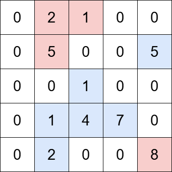

# 3619. Count Islands With Total Value Divisible by K

You are given an `m x n` matrix `grid` and a positive integer `k`. An **island** is a group of **positive** integers (representing land) that are **4-directionally** connected (horizontally or vertically).

The **total value** of an island is the sum of the values of all cells in the island.

Return the number of islands with a total value **divisible by** `k`.

 

# **Example 1:**

**Input:** grid = \[\[0,2,1,0,0\],\[0,5,0,0,5\],\[0,0,1,0,0\],\[0,1,4,7,0\],\[0,2,0,0,8\]\], k = 5

**Output:** 2

**Explanation:**

The grid contains four islands. The islands highlighted in blue have a total value that is divisible by 5, while the islands highlighted in red do not.

 

# **Example 2:**

**Input:** grid = \[\[3,0,3,0\], \[0,3,0,3\], \[3,0,3,0\]\], k = 3

**Output:** 6

**Explanation:**

The grid contains six islands, each with a total value that is divisible by 3.

 

# **Constraints:**

*   `m == grid.length`
*   `n == grid[i].length`
*   <code>1 &lt;= m, n &lt;= 1000</code>
*   <code>1 &lt;= m * n &lt;= 105</code>
*   <code>0 &lt;= grid[i][j] &lt;= 106</code>
*   <code>1 &lt;= k &lt;= 106</code>

 

Hint 1
Use a BFS/DFS to find connected components.

